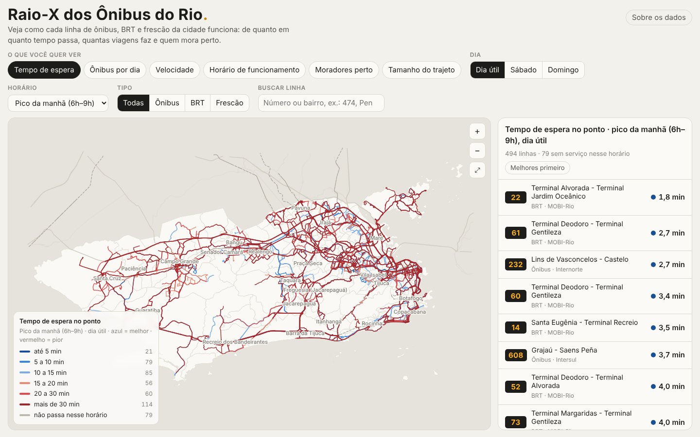

# Raio-X dos Ônibus do Rio

Análise da rede de ônibus do município do Rio de Janeiro a partir do GTFS da SMTR (programação de junho de 2026), cruzada com a população do Censo 2022 e a rede de ruas do OpenStreetMap, e um painel interativo para consultar as 494 linhas.

**Painel online: https://gabriel-mottagm.github.io/analyse_bus_network_rio/**



## O que tem aqui

| Pasta | Conteúdo |
|---|---|
| `painel/` | Painel "Raio-X dos Ônibus do Rio": página HTML única (mapa em Canvas, sem bibliotecas externas) + `data/linhas.json` e `data/contexto.json` |
| `scripts/` | Pipeline em Python (só numpy, scipy, pandas e matplotlib), em ordem de execução |
| `resultados/` | Tabelas (CSV) e mapas (PNG) gerados pelo pipeline |
| `reserva_secao_territorial/` | Camadas territoriais, aba Bairros e indicadores de perfil da área atendida, retirados do painel por enquanto (ver abaixo) |
| `docs/` | Perfil dos dados GTFS, plano e método, decisões do painel, avaliação do OSM |
| `dados/` | GTFS usado (zip) e instruções para obter os outros insumos |
| `tests/` | Testes do painel com Playwright |

## Principais resultados

Tudo é **serviço programado** (não há demanda, GPS nem cumprimento de viagens no GTFS).

- 494 linhas (436 ônibus, 30 BRT, 28 executivos), 7.694 paradas; 104.014 partidas expandidas a partir de `frequencies.txt` (50.310 em dia útil).
- **68,0% dos moradores estão a até 400 m a pé de uma parada** (85,8% se medido em linha reta). O caminho real é, na mediana, 1,44 vez a linha reta.
- 55% têm 10 ou mais ônibus por hora no pico a até 400 m a pé; 32% não têm parada a essa distância.
- Renda: no décimo mais pobre, 40,9% estão a 400 m a pé de uma parada; no 9º décimo, 85,1%.
- **1,19 milhão de pessoas** estão nos 30% mais pobres e têm pouca oferta (sem parada a 400 m a pé ou menos de 10 ônibus/h no pico). Os maiores contingentes estão em Santa Cruz, Maré, Bangu, Jacarepaguá e Senador Camará.
- Intervalo mediano no pico da manhã: 16,5 min por linha; frota mínima estimada no pico: ~4,1 mil ônibus.

Detalhes e ressalvas: [docs/plano-e-metodo.md](docs/plano-e-metodo.md).

## Painel

Modo geral (para o público):
- linhas coloridas por tempo de espera, ônibus por dia, velocidade, horário de funcionamento, moradores perto e tamanho do trajeto;
- filtros por dia, horário e tipo de linha;
- ficha de cada linha.

Modo técnico:
- seis indicadores a mais: frota, km/dia, tortuosidade, ida ≠ volta, moradores a 800 m e moradores por partida;
- tabela com colunas configuráveis e filtros por faixa de valor;
- exportação em CSV.

O mapa de fundo é o [OpenFreeMap](https://openfreemap.org) (estilos Positron e Dark, dados do OpenStreetMap), desenhado pelo MapLibre GL JS 4.7.1, que vai em `painel/vendor/` (licença BSD-3). As linhas continuam num canvas próprio por cima. Quando o fundo não carrega, aparece um fundo simplificado feito com os setores do Censo e as vias do OSM.

**Ônibus ao vivo:** ao abrir uma linha, o painel mostra os ônibus dela que estão transmitindo posição, a partir da API de geolocalização da SMTR (beta). Como a API não libera chamadas de outros sites, há um pequeno intermediário na Cloudflare, explicado em [cloudflare/README.md](cloudflare/README.md).

Para abrir localmente, sirva a pasta por HTTP (a página carrega os JSON com `fetch`):

```bash
cd painel && python3 -m http.server 8000
# abrir http://localhost:8000
```

`painel/index.html` é a fonte única do painel. Ele é publicado de dois jeitos:
- como Artifact no Claude, onde "Baixar CSV" usa a capability `downloads`;
- no GitHub Pages, onde o download é o comum do navegador.

A cada push no `main` que mexe em `painel/`, o workflow `.github/workflows/pages.yml` roda `scripts/05_painel/montar_site.sh`. Esse script acrescenta o cabeçalho HTML completo e publica o resultado na branch `gh-pages`.

Decisões de produto e histórico de versões: [docs/painel.md](docs/painel.md).

## Como reproduzir

1. Prepare a pasta de trabalho (fica fora do git, ver `.gitignore`), seguindo [dados/README.md](dados/README.md):
   ```
   trabalho/gtfs/                  unzip dados/gtfs_smtr_2026-06.zip -d trabalho/gtfs
   trabalho/censo/setores.geojson  Censo 2022 por setor (data.rio)
   trabalho/osm/rio.osm.gz         extrato OSM do Rio (BBBike)
   ```
2. Instale as dependências: `pip install -r requirements.txt`.
3. Rode `./pipeline.sh trabalho`. Leva de 15 a 25 minutos e usa uns 6 GB de memória.

| Etapa | Scripts | Saídas principais |
|---|---|---|
| 1. GTFS | `01_gtfs/expandir_gtfs.py` | `out/partidas_expandidas.csv`, `resumo_paradas.csv`, `passagens_parada_hora.csv` |
| 2. Linha reta (comparação) | `02_linha_reta/raster.py` → `cobertura.py` → `mapa.py`, `mapas_renda.py` | `censo/grade.npz`, `cob/*.csv`, mapas |
| 3. Distância a pé (referência) | `03_a_pe/rede_caminhada.py` → `pop_vias.py` → `dist_a_pe.py` → `agrega_a_pe.py` → `mapas_a_pe.py` | `ape/*.csv`, `ape/mapa_a_pe_*.png` |
| 4. Indicadores por linha | `04_indicadores/ind_oferta.py` → `ind_tracado.py` → `ind_pop_linha.py` → `ind_monta.py` → `ind_pontos_parada.py` | `linhas/indicadores_linhas.csv` (494 × 39) |
| 5. Painel | `05_painel/painel_contexto.py`, `painel_linhas.py` | `painel/data/*.json` |

Scripts de exploração (`01_gtfs/perfil_tabelas.py`, `metricas_viagens.py`, `explorar_mais.py`) e diagnósticos do OSM (`diagnosticos/`) não fazem parte do pipeline.

### Método em uma frase por etapa

- **Tempo de espera**: método do busmadrid.org. Por sentido, calcula-se 60 × horas com partida ÷ partidas; o valor da linha é a média dos sentidos.
- **População**: os 6.211.223 moradores dos 13.782 setores do Censo 2022 são distribuídos em pontos a cada 20 m ao longo das ruas residenciais e de pedestres de cada setor.
- **Distância a pé**: Dijkstra com várias origens na rede de caminhada do OSM (19,8 mil km de vias); cada parada é ligada ao nó mais próximo da rede.
- **Ônibus por hora no pico**: partidas de dia útil entre 6h e 9h ÷ 3. Somam-se as linhas com parada a até 400 m a pé, contando o sentido mais frequente de cada uma.

## Seção territorial (reservada)

As camadas de mapa estão em `reserva_secao_territorial/`, com a página v3 e a v5. Foram tiradas do produto por enquanto porque punham muita informação num mapa só:
- ônibus perto de casa;
- renda × ônibus;
- onde falta ônibus;
- caminho até o ponto.

Também estão lá a aba Bairros (166 bairros) e o perfil da área atendida por linha: % de moradores nos 30% mais pobres e nos 30% mais ricos, % de pretos e pardos e renda média. A ideia é voltar com tudo isso numa seção própria, com mapa separado. Os valores do perfil continuam em `resultados/linhas/indicadores_linhas.csv`.

## Limitações

- Só serviço programado. Comparar programado × realizado exigiria o GPS dos ônibus.
- Ficam de fora vans, trem, metrô, VLT e barcas; parte das áreas "sem parada" é atendida por eles.
- A rede de caminhada não tem relevo: ladeiras e escadarias contam só pela distância.
- O GTFS vence em 31/12/2026.

## Fontes

- GTFS: SMTR, Prefeitura do Rio (arquivos de 03/06/2026).
- Censo Demográfico 2022, setores censitários: IBGE, via data.rio.
- OpenStreetMap: © colaboradores do OpenStreetMap, licença ODbL; extrato via BBBike.
